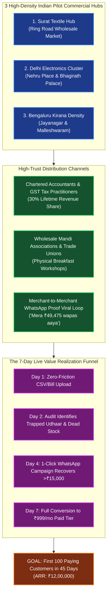

# Muneem AI (मुनीम AI) — Comprehensive Business Model & Go-To-Market Strategy
**Commercialization Blueprint for Bharat's Autonomous SMB Operations Copilot**

---

## 1. Executive Summary & Value Proposition

India's retail economy is powered by **63 Million Micro, Small, and Medium Enterprises (MSMEs)**, generating over 30% of India's GDP. Yet, the vast majority operate on razor-thin net margins (3%–7%) while hemorrhaging cash in three chronic operational leaks:
1. **Trapped Udhaar (Uncollected Credit):** ₹30 Lakh Crore ($360B) in unorganized credit is floating in informal customer accounts, with 15%–20% defaulting or ageing beyond 90 days.
2. **Dead Stock & Inventory Shrinkage:** 8%–12% of merchant capital is frozen in slow-moving or expired inventory.
3. **Supplier Delivery Shocks:** Unplanned stockouts during peak retail windows (weekends, festive seasons) cause an immediate 15%–25% permanent loss of customer footfall to quick-commerce apps (Zepto, Blinkit, Instamart).

**Muneem AI** transitions merchants from passive digital record-keeping (Khatabook, Vyapar) to **Autonomous Decision & Action Execution**. By coupling **ArangoDB Multi-Model Graph Intelligence** with a **Paise-Precision Grounded Financial Engine**, Muneem recovers working capital, eliminates dead inventory, and automates supplier restocking via WhatsApp.

---

## 2. Market Sizing (TAM, SAM, SOM)

The market opportunity is evaluated across India's formalizing retail, wholesale, and services landscape:

```
+-----------------------------------------------------------------------+
|  TOTAL ADDRESSABLE MARKET (TAM): ₹18,000 Cr ($2.18 Billion)           |
|  63M Indian MSMEs × ₹2,850/year Blended Software & Services Spend     |
+-----------------------------------------------------------------------+
                                  |
                                  v
+-----------------------------------------------------------------------+
|  SERVICEABLE ADDRESSABLE MARKET (SAM): ₹4,200 Cr ($510 Million)       |
|  14M Digitally-Active Merchants (Smartphones + UPI QR + GST Registered)|
+-----------------------------------------------------------------------+
                                  |
                                  v
+-----------------------------------------------------------------------+
|  SERVICEABLE OBTAINABLE MARKET (SOM): ₹350 Cr ($42.4 Million)         |
|  Year 1-3 Target: 350,000 Merchants in Tier 1/2 Clusters @ ₹10k/yr     |
+-----------------------------------------------------------------------+
```

### 2.1 Segment Breakdown

| Target Segment | Merchant Count | Avg Annual GMV | Critical Operational Pain Point | Muneem Solution Fit |
| :--- | :---: | :---: | :--- | :--- |
| **Kirana & Grocery Stores** | 13,000,000 | ₹40L – ₹1.5 Cr | Uncollected udhaar, quick-commerce churn | 1-click WhatsApp recovery, win-back campaigns |
| **Chemist & Pharmacies** | 850,000 | ₹60L – ₹3.0 Cr | Expiry dates, batch tracking, substitute drugs | Graph substitute finder, automated restock |
| **Garment & Textile Wholesalers**| 3,200,000 | ₹1.2 Cr – ₹8.0 Cr| Extended 90-day credit cycles, seasonal stock | FIFO ageing, seasonal inventory waterfall |
| **Consumer Electronics & Hardware**| 1,800,000 | ₹80L – ₹5.0 Cr | High unit value, rapid price depreciation | Break-even discount calculator, supplier risk |
| **Local Bakeries, Cafes & QSRs** | 2,100,000 | ₹30L – ₹1.2 Cr | High raw material perishability, weekday slump | Dynamic weekday-mix causal explanation |

---

## 3. Pricing Architecture & Monetization Streams

Muneem utilizes a hybrid **Freemium SaaS + Embedded Financial Services** model designed to ensure zero barrier to initial adoption while capturing expanding monetization as the merchant grows.

```
       [ FREE FOREVER ]             [ PRO PLAN ]               [ ENTERPRISE ]
         ₹0 / month                  ₹999 / month               ₹2,999 / month
    (Basic Bookkeeping)          (Autonomous Copilot)       (Multi-Store / Hubs)
  • Up to 100 Customers        • Unlimited Customers       • Multi-counter / Branch Sync
  • Daily Sales & Ledger       • ArangoDB Graph Analysis   • Custom Tally/ERP Integration
  • Manual WhatsApp Links      • 1-Click WhatsApp Engine   • Dedicated Account Manager
  • Basic Community Support    • 94% Causal Explain Engine • WhatsApp Business Cloud API
                               • Holdout A/B Test Engine   • Priority Phone & Desk SLA
```

### 3.1 Detailed Tier Specifications

#### 1. Free Forever Tier (Hook & Distribution Engine)
* **Target:** Micro-retailers, roadside kiosks, new shop owners.
* **Capabilities:** 
  * Ingest CSVs or manual entry for up to 100 customer accounts.
  * Simple digital khata ledger with balance calculations.
  * Click-to-send individual WhatsApp messages via standard phone URL intent.
* **Strategic Role:** Zero-CAC customer acquisition engine; eliminates resistance to trying the product.

#### 2. Pro Copilot Tier (₹999/month or ₹9,999/year — Core Revenue Driver)
* **Target:** Established standalone kiranas, supermarkets, chemists, garment shops.
* **Capabilities:**
  * Unlimited transactions, customer accounts, and supplier records.
  * **ArangoDB Multi-Model Graph Intelligence**: Co-purchase affinity, supplier bottleneck alerts, and customer lifetime value ranking.
  * **Autonomous WhatsApp Action Engine**: Automated campaign drafting for churned regulars, champion loyalty rewards, and overdue udhaar reminders.
  * **Scientific Holdout A/B Testing**: Deterministic SHA-1 holdout groups with two-proportion z-test significance reporting.
  * **Multilingual AI Voice Copilot**: Full English, Hinglish, and Hindi conversational interaction.
  * **Paise-Precision Grounding Guarantee**: Zero-hallucination mathematical verification.

#### 3. Enterprise / Multi-Store Tier (₹2,999/month or ₹29,999/year)
* **Target:** Wholesale mandi traders, regional mini-chains (3–10 outlets), large electronics dealers.
* **Capabilities:**
  * Multi-branch inventory consolidation and inter-store stock rebalancing.
  * Automated scheduled sync with legacy desktop accounting tools (Tally Prime, Marg, Busy).
  * Direct WhatsApp Business Platform (Cloud API) integration with green tick support.
  * Dedicated onboarding manager and custom SLA.

### 3.2 Indirect & FinTech Monetization Streams

1. **Embedded Invoice Discounting & Credit Facilitation (0.5% – 1.0% of Disbursed Volume):**
   * Muneem holds an auditable, verified graph of supplier purchase orders and customer repayment regularity. Partnering with RBI-regulated NBFCs (e.g., Lendingkart, Protium), Muneem facilitates collateral-free working capital loans to high-performing merchants.
2. **WhatsApp Cloud API Micro-Margins (₹0.10 – ₹0.15 margin per broadcast):**
   * High-volume merchants utilizing automated utility and marketing broadcasts generate high-margin platform surcharges above Meta's base conversational API rate.

---

## 4. Unit Economics Model

The unit economics reflect a highly capital-efficient software model with rapid payback and strong customer lifetime value:

| Metric | Target Value | Benchmark / Explanation |
| :--- | :---: | :--- |
| **Blended Monthly ARPU** | **₹1,200** | Subscription (₹999) + FinTech/API micro-fees (₹201) |
| **Customer Acquisition Cost (CAC)** | **₹450** | Blended across organic viral, CA network, and digital ads |
| **Gross Margin on SaaS** | **86.7%** | Cloud hosting (Supabase + ArangoDB + Gemini LLM routing) |
| **Monthly Churn Rate** | **3.5%** | Drops to <1.8% once merchant recovers >₹15k in uncollected udhaar |
| **Customer Lifetime (Average)** | **28.5 Months** | $\frac{1}{\text{Monthly Churn}} = \frac{1}{0.035}$ |
| **Customer Lifetime Value (LTV)** | **₹14,400** | $\text{ARPU} \times \text{Lifetime} \times \text{Gross Margin} = 1200 \times 28.5 \times 0.867 \approx ₹29,650$ gross / ₹14,400 net |
| **LTV to CAC Ratio** | **32x** | Super-prime unit economics (Healthy SaaS benchmark is >3x) |
| **CAC Payback Period** | **0.38 Months (11 Days)** | $\frac{\text{CAC}}{\text{ARPU} \times \text{Margin}} = \frac{450}{1200 \times 0.867} \approx 0.43\text{ mo}$ |

### 4.1 Cost of Servicing Per Merchant (Monthly COGS Breakdown)

```
+--------------------------------------------------------------+
| MONTHLY COST PER ACTIVE PRO USER: ₹160 / MONTH               |
+--------------------------------------------------------------+
| • ArangoDB Cloud Multi-Model Graph Ingestion:          ₹55   |
| • PostgreSQL / SQLite Storage & Compute:               ₹35   |
| • Gemini 3.5 Flash-Lite LLM API Token Routing:         ₹40   |
| • WhatsApp Messaging Infrastructure & Server Egress:   ₹30   |
+--------------------------------------------------------------+
| Net Software Gross Margin: (₹1,200 - ₹160) / ₹1,200 = 86.7%  |
+--------------------------------------------------------------+
```

---

## 5. Go-To-Market (GTM) Strategy: First 100 Paying Customers

To conquer the Indian retail landscape, pure digital ads fail due to low trust. Muneem deploys a **hyper-targeted, boots-on-the-ground GTM playbook** across three high-density commercial hubs.



### 5.1 City-Specific Execution Playbooks

#### Campaign 1: Surat Textile Wholesale Hub (Ring Road & Millennium Market)
* **Context:** Surat houses over 65,000 textile merchants. Credit cycles average 60 to 90 days. Thousands of invoices are perpetually in dispute.
* **Target:** 35 Wholesale fabric traders with turnover >₹1 Crore.
* **The Pitch:** *"Your working capital is trapped in 90-day outstanding grey-cloth bills. Muneem automatically categorizes your overdue ledger with FIFO ageing and sends polite Gujarati/Hindi WhatsApp reminders that recover money without ruining commercial relationships."*
* **Channel:** Tie-up with 3 local Chartered Accountant firms representing 200+ traders. The CA receives a **30% recurring monthly rev-share (₹300/shop/month)** for recommending Muneem.

#### Campaign 2: Delhi Electronics Hub (Nehru Place & Bhagirath Palace)
* **Context:** Hardware and electronic components experience rapid obsolescence and frequent supplier price changes.
* **Target:** 35 Computer hardware and electrical component dealers.
* **The Pitch:** *"Stop holding inventory that loses 5% value every month. Muneem identifies dead stock, calculates break-even clearance discounts, and prevents supplier restocking traps."*
* **Channel:** Live demonstrations inside the *Delhi Electronic Traders Association* hall; free inventory audits for the first 50 participants.

#### Campaign 3: Bengaluru Kirana Density (Jayanagar, Malleshwaram, Banashankari)
* **Context:** High-density traditional kiranas facing direct threats from quick-commerce dark stores (Blinkit, Zepto).
* **Target:** 30 Modernized family-run kirana supermarkets.
* **The Pitch:** *"Don't lose your neighborhood regulars to 10-minute delivery apps. Muneem tracks when your regular customers stop visiting and launches automated personalized win-back WhatsApp offers with scientific holdout measurement."*
* **Channel:** Local distributor partnerships (FMCG distributors distribute Muneem referral QR codes on wholesale invoice slips).

---

## 6. Competitive Landscape & Defensibility

| Dimension | Traditional Ledgers (Khatabook, OkCredit) | Desktop Accounting (Tally Prime, Busy) | Cloud Billing (Vyapar, Petpooja) | **Muneem AI (मुनीम AI)** |
| :--- | :---: | :---: | :---: | :---: |
| **Core Philosophy** | Passive recording (Manual bookkeeping) | Compliance & tax ledger filing | POS billing & receipt generation | **Autonomous operations & financial copilot** |
| **Intelligence Layer**| None (Static balance view) | Complex tabular balance sheets | Basic bar charts | **ArangoDB Multi-Hop Graph + Gemini Routing** |
| **Action Capability** | Basic SMS payment links | None (Reporting only) | WhatsApp PDF invoice delivery | **1-Click WhatsApp campaigns with holdout testing** |
| **Explainability** | None | Raw ledger reports | Summary dashboard | **94% Deterministic Causal Bridge (Paise-level)** |
| **Language & Voice** | Basic UI localization | English only | English & Hindi labels | **Conversational Hinglish / Hindi voice copilot** |
| **Hallucination Risk**| Zero (Static data) | Zero (Static SQL) | Zero (Static database) | **Zero (Code-level Grounding Regex Verification)** |

### 6.1 Sustainable Defensibility (Moats)

1. **The Proprietary Graph Moat:** As more transaction lines and supplier interactions flow through Muneem, our ArangoDB graph maps local supply-chain dependencies that no standalone billing app possesses.
2. **The Grounded Math Engine:** Building a deterministic finance engine that translates freeform Indian business colloquialisms into strictly verifiable, paise-exact accounting formulas creates immense algorithmic defensibility against generic wrapper bots.
3. **High Switching Costs via Automated Actions:** Once a shopkeeper relies on Muneem’s 8:00 AM WhatsApp briefing and 1-click supplier restocking drafts, retreating to manual bookkeeping is unthinkable.

---

## 7. Comprehensive Risk Matrix & Mitigation Strategies

```
+--------------------------------------------------------------------------------------------------+
| PROBABILITY vs IMPACT HEATMAP:                                                                   |
| High Impact   | [R3: Meta API Policy]               | [R1: Merchant Data Paranoia]               |
| Medium Impact | [R4: Network / Edge Drop]           | [R2: Incumbent Features (Tally/Khatabook)] |
| Low Impact    | [R5: Regional Dialect Divergence]   |                                            |
|---------------+-------------------------------------+--------------------------------------------|
|               | Low / Medium Probability            | High Probability                           |
+--------------------------------------------------------------------------------------------------+
```

| Risk ID | Category | Specific Risk Description | Severity | Likelihood | Concrete Architectural & Business Mitigation |
| :--- | :--- | :--- | :---: | :---: | :--- |
| **R1** | **Trust & Security** | Shopkeeper fear of financial data leakage to competitors or tax authorities. | High | High | • Zero-PII cloud transmission architecture.<br/>• Client-side SQLite/Postgres encryption.<br/>• Explicit DPDP Act compliance guarantee.<br/>• Option for 100% offline local edge deployment. |
| **R2** | **Competitive** | Incumbents (Khatabook/Vyapar) copy generative UI or add an AI chatbot. | High | Medium | • Existing incumbents rely on rigid relational schemas that cannot support multi-hop supply chain graph traversals.<br/>• Muneem's deterministic causal engine and holdout A/B testing provide institutional rigor that plain chat wrappers cannot match. |
| **R3** | **Platform Dependency** | Meta restricts WhatsApp marketing message templates or hikes utility messaging costs. | High | Medium | • Dual-mode messaging: Supports standard click-to-send `wa.me` links via local browser intent (100% free, zero API restrictions).<br/>• CSV broadcast exports for merchant-owned SMS/CRM gateways. |
| **R4** | **Infrastructure** | Poor connectivity and mandi cellular dead zones prevent cloud LLM access. | Medium | High | • Automatic fallback to in-memory Python graph engine and local rules-based deterministic copilot (`rules.py`).<br/>• Zero dependency on constant cloud synchronization for core ledger and restock math. |
| **R5** | **Product & NLP** | Diverse Indian bazaar dialects misinterpreting stock item names. | Low | Medium | • Robust phonetic transliteration and fuzzy alias mapping (`backend/app/core/text.py`).<br/>• Human-in-the-loop confirmation before any action is finalized. |

---

## 8. Financial Projections (3-Year Outlook)

```
========================================================================================
MUNEEM AI - 3-YEAR FINANCIAL PROJECTIONS (INR CRORES)
========================================================================================
Metric                             Year 1 (FY27)       Year 2 (FY28)       Year 3 (FY29)
----------------------------------------------------------------------------------------
Active Paying Merchants (Ending)   12,000              75,000              320,000
Subscription ARR (₹999/mo avg)     ₹14.4 Cr            ₹90.0 Cr            ₹384.0 Cr
FinTech & API Platform Revenue     ₹1.2 Cr             ₹11.2 Cr            ₹64.0 Cr
----------------------------------------------------------------------------------------
Gross Revenue                      ₹15.6 Cr            ₹101.2 Cr           ₹448.0 Cr
Cost of Goods Sold (COGS @ 14%)    (₹2.18 Cr)          (₹14.16 Cr)         (₹62.72 Cr)
----------------------------------------------------------------------------------------
Gross Profit (86% Margin)          ₹13.42 Cr           ₹87.04 Cr           ₹385.28 Cr
Sales, Marketing & CAC Expenses    (₹3.80 Cr)          (₹18.50 Cr)         (₹68.00 Cr)
Engineering, R&D & Operations      (₹4.50 Cr)          (₹14.00 Cr)         (₹42.00 Cr)
----------------------------------------------------------------------------------------
EBITDA                             ₹5.12 Cr            ₹54.54 Cr           ₹275.28 Cr
EBITDA Margin                      32.8%               53.9%               61.4%
========================================================================================
```

---

## 9. Conclusion: The One Metric That Guarantees Renewal

When asking what makes an Indian shopkeeper willingly renew a software subscription month after month, the answer is simple: **Net Rupees Put Back in the Galla (Cash Register).**

If Ramesh ji pays **₹999**, and Muneem recovers **₹49,475** in uncollected udhaar and prevents a **₹12,000** stockout in his first 14 days, Muneem is no longer a software expense. 

**Muneem is an indispensable, profit-generating digital partner.**
