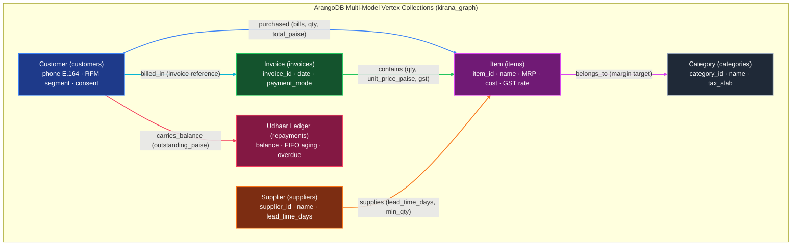
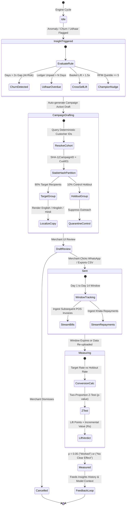

# Muneem v2 — AI-first Super CRM for Merchants

Assessment, target architecture and phased build plan. Written 14 Nov 2026 against the code at
commit `7a6ae70`. Nothing in this document is implemented yet unless marked **(exists)**.

---

## 0. Decisions (confirmed 14 Nov 2026)

| Question | Decision |
| --- | --- |
| Database | **PostgreSQL now as system of record + ArangoDB for the graph** (moves storage from Phase 8 into Phase 1) |
| Business focus | **Kirana-first demo, general merchant data model** |
| Web research | **Tavily + TinyFish keys available** — owner adds `TAVILY_API_KEY` and `TINYFISH_API_KEY` to `.env` |
| Start | **Phases 1–3** |

Storage plan under this decision: SQLAlchemy repository with PostgreSQL in production
(`DATABASE_URL` in `.env`, e.g. Neon/Supabase); tests run against an in-memory SQLite copy of
the same schema so they stay fast and offline. ArangoDB keeps the graph projection.

## Progress

**Phase 1 done (14 Nov 2026):**
- Customers on bills (59% of bills linked; all credit bills), udhaar ledger with FIFO ageing,
  identity resolution (merge by phone, phone-only bills, unknown customers created),
  customer and repayment uploads.
- PostgreSQL store via SQLAlchemy (switches on with `DATABASE_URL`; SQLite in tests);
  ArangoDB gets customers, repayments and `purchased` edges.
- Metrics layer: 15 metrics × 11 dimensions × periods (incl. month-to-date vs same days last
  month).
- CRM analytics: RFM segments, churn risk, udhaar overdue, cohorts, lifecycle funnel, customer
  360.
- 7 new agent tools + rules-mode intents; `/api/metrics/*` and `/api/customers/*` endpoints.
- 121 tests pass; live Gemini eval 26/27 (the miss was fixed and rechecked).

Planted CRM stories found: 14/14 churned regulars, all 5 overdue khata accounts with exact
balances, total udhaar ₹49,475.50 to the paisa.

**Phase 2 done (14 Nov 2026):**
- `explain_change`: bills × average-bill bridge plus estimated causes (weekday mix, festival,
  regulars who stopped coming, probable stock-outs, price changes) and a remainder; every
  breakdown adds up to the paisa. "Why did sales drop this week?" → −20.1%, 94% explained by
  fewer weekend days + the Diwali rush being in the earlier period.
- Insight engine: 11 detectors → findings with what / why (English + Hinglish), ₹ impact,
  severity, urgency, one action and a re-runnable evidence tool; statuses (seen / acted /
  dismissed) saved in Postgres.
- `/api/findings`, `/api/explain`; chat tools `top_insights`, `explain_change`; rules intents
  for "why" and "what should I focus on". 134 tests pass; live Gemini eval 30/30.

**Phase 3 done (14 Nov 2026):**
- Every tool result in a chat turn is a dataset (`d1`, `d1.bridge` ...) with typed columns;
  `make_chart(dataset_id, kind, x, y)` lets the model choose the chart, validated in code
  (columns exist, numeric, no mixed units, funnel must decrease, pie > 8 parts grouped as
  "Other"). The model never supplies chart numbers; errors go back to it to fix.
- Kinds: line, area, bar, stacked bar, pie, funnel, waterfall, cohort heatmap, scatter - drawn
  interactively in the app and as Matplotlib PNG (`/api/charts/{id}.png`) for WhatsApp/reports.
- Better defaults: waterfall for "why did sales change", funnel, cohort heatmap, customer
  scatter (days since last bill × monthly spend, coloured by segment).
- 154 tests pass. Live Gemini: 30/33 in a full run - the 3 misses were quota/timeout
  fallbacks to rules mode; re-run individually they pass (pie chart via make_chart, 6/6
  numbers verified). Gemini latency was 20-40 s during testing (service slow); timeout
  raised to 25 s.

**Phase 4 done (14 Nov 2026):**
- Campaigns: win back, reward champions, welcome new, cross-sell (buyers of A who never bought
  B), udhaar reminders (with each customer's exact balance). Messages in English / Hinglish /
  Hindi; offers only when the owner writes one. Draft → sent (owner sends via WhatsApp links /
  CSV) → measured; Postgres-backed.
- Hold-out: an exact share chosen by a stable hash (≥1 customer for groups of 5+), so effects
  are measured against customers who got no message: return rate, extra sales, two-proportion
  p-value, verdict ("worked" / "no clear effect" / "too few to tell").
- Sample data has a past Diwali win-back with a 25% hold-out: 84.2% vs 55.0% came back,
  +₹29,208 extra sales, p = 0.0002 - recomputable from the sales table.
- Insight actions now open real campaigns (win-back, reminders, welcome, cross-sell).
- Chat tools `draft_campaign`, `campaign_results`; `/api/campaigns/*`. 168 tests pass; live
  Gemini campaign questions 4/4 grounded.

**Phase 5 done (14 Nov 2026):**
- Orbit-style app: light sidebar (New chat, workspace, recent chats, EN / Hinglish / हिं switch,
  Postgres/ArangoDB status); Home = greeting + 5-tile health strip (sparkline) + today's briefing
  (what · why · ₹ impact · one action) + suggestions + composer; chats reopen with charts.
- Pages: Insights (filter, Ask Muneem, Done, Dismiss), Customers (segment chips, scatter, table,
  "draft messages to this segment"), Customer 360 (stats, monthly spend, items, udhaar, one
  context-aware message button), Campaigns (new + preview, edit, WhatsApp per message, CSV, mark
  sent, results card with hold-out comparison). Existing Orders / Business / Data kept.
- Insight → action in two clicks: briefing button creates the draft and opens it; WhatsApp
  button sends.
- Live: Postgres (Supabase) and ArangoDB cloud connected - dataset round-trips; AQL graph results
  identical to the in-memory engine. 169 tests pass.

**Phase 6 done (14 Nov 2026):**
- Profiler: each column typed from its values (identifier, integer, decimal, money, percent,
  date, phone, email, GSTIN, UPI, boolean, category, text) with null / distinct %, examples,
  outliers.
- Classifier: which business table a file is (products, bills, stock, expenses, suppliers,
  customers, repayments) from header words + value types + how much of the file each type
  explains (+ file-name hint).
- Mapper: every field gets a column and a confidence (header words incl. Indian billing terms,
  value-type fit, value checks such as GST slabs and payment words, MRP > cost); "sure" ≥ 75%,
  "please check" otherwise; weak guesses only for required fields. Optional AI proposals for
  still-unclear columns, validated and always confirmed.
- Links: expected references checked by coverage (bills → products 100% …) and unknown links
  discovered by value inclusion. Confirmed layouts are remembered by header signature
  (Postgres), so the next export maps itself.
- Connectors: analyze → confirm → commit API; read-only SQL import (PostgreSQL/MySQL; reflected
  tables, read-only session, server-local SQLite refused); HMAC-signed webhook that appends
  bills/expenses/repayments or upserts products/stock/customers, re-validating everything
  (a bad batch changes nothing).
- Data page: upload or connect, review with highlighted fields, links, "remember this layout".
- Unseen billing export (generic file names, "Bill No.", "Bill Dt" dd-mm-yyyy, "Rate (incl.
  GST)", "Tax %", Paytm/Udhaar, customer phones, junk columns): all tables and fields mapped,
  nothing to confirm, same revenue after import. 184 tests pass.

**Phase 7 done (14 Nov 2026):**
- `app/research/web.py`: Tavily search (basic depth = 1 credit, India, optional day/week/month
  window, published dates) and TinyFish page reading (structured output: found/not_found,
  label/value facts, summary). One-day cache, daily caps per provider, friendly errors.
- Privacy guard: before any query leaves the server, phones, emails, UPI ids, GSTINs, rupee
  amounts / long numbers, internal ids, customer full names and the shop name are removed; the
  evidence says what was removed. Page reading accepts only public `https` addresses.
- Agent tools `web_search` / `web_extract` (hidden from the model when the key is missing);
  prompt rule 13: outside context only, never the shop's numbers, web facts in their own
  "From the web:" sentence with site and date. Rules mode answers market/news/GST-rule questions
  with a dated source list.
- Separation: answers carry a `sources` list (title, link, site, published date, retrieved
  time, provider) shown as a "From the web" block under the answer; web evidence is tagged; web
  figures count as "from the web", never as "verified" shop numbers.
- Live: "latest news on sugar market price" → 5 sources dated 12–13 Nov 2026; TinyFish read a
  page in 4 steps. This TinyFish account has no custom step limit (beta), so the client falls
  back to the provider default and relies on the daily run cap. 208 tests pass.

## 1. Verdict in one paragraph

The current Muneem already has the hardest part of the vision right: **a deterministic engine
that does all the maths, an LLM that only picks tools and writes words, and a check that every
number in an answer exists in the computed data.** What it lacks is the *customer* half of a
CRM (there is no customer entity at all), a general metrics layer the AI can query flexibly, an
insight engine that turns detections into "what / why / what to do", visualisation choice by
question type, ingestion that understands unknown files, web research, and a chat-first UI. All
of these can be added on top of the existing architecture without rewriting it.

---

## 2. What already works — keep it

| Area | What exists today | Why keep it |
| --- | --- | --- |
| Deterministic engine | GST back-out, margins, KPIs, festival-aware reorder maths, dead stock, expenses — pure Python, money in paise **(exists)** | Matches "AI never invents metrics" exactly |
| Tool-calling agent | 21 typed tools, Pydantic-validated args, Gemini with model fallback, rules-only mode **(exists)** | Same pattern scales to CRM tools |
| Grounding check | Every number in an answer is matched against tool results; ungrounded ones flagged **(exists)** | The core trust mechanism; extend to external sources |
| Evidence envelope | answer + evidence (tool, args, formula, rows) + visuals + actions **(exists)** | Already the right response contract |
| Validation | Row-level report, alias headers, Hinglish payment words, strict/partial **(exists)** | Becomes the last stage of the smarter ingestion pipeline |
| Graph | ArangoDB `kirana_graph` + identical in-memory engine; supplier risk, bought-together with significance **(exists)** | Relationship questions (customer ↔ product ↔ supplier) |
| Actions | Purchase-order drafts, WhatsApp messages in 3 languages, sent → received lifecycle that updates stock **(exists)** | Template for campaigns and reminders |
| Eval + tests | 101 tests, 20-question eval live on Gemini **(exists)** | Keeps quality measurable while we expand |

## 3. Gaps against the vision

| Vision requirement | Today | Needed |
| --- | --- | --- |
| Customers, value, churn, segments | No customer entity; bills are anonymous | Customer model, identity on bills (phone / UPI / khata), RFM, churn risk, cohorts, lifetime value |
| "Compare this month with last month", "why did revenue drop" | Fixed reports only | A **metrics layer** (named metrics × dimensions × period × comparison) and a **change-explanation** tool |
| Insights = what / why / do | Alerts exist, but not one consistent shape | **Insight engine**: detectors → Insight objects with impact in ₹ and a one-click action |
| Visualisation chosen per question | Each tool emits a fixed chart | A **visualisation tool** the agent calls with a chart type over a dataset reference; interactive + Matplotlib PNG; funnel, cohort heatmap, waterfall, segment scatter |
| Smart ingestion from many sources | CSV/XLSX with known table names | Profiler, entity classifier, field mapper with confidence, relationship + duplicate detection, saved source profiles; SQL and webhook connectors |
| External intelligence | None | Tavily search + TinyFish extraction, clearly separated, with sources and timestamps |
| Campaigns / outreach | Only supplier orders | Segment → message → send links / export → measured result with a hold-out group |
| Chat-first premium UI | Card dashboard + separate chat page | Orbit-style home: briefing + composer + recent chats; insights feed; customer 360 |
| Database | In-memory pandas + optional ArangoDB | A system of record (see §10) behind a repository interface |

---

## 4. Target architecture

```
 Sources                     Ingestion (deterministic first, LLM only proposes)
 ───────                     ─────────────────────────────────────────────────
 CSV / XLSX ──┐   ┌───────────────────────────────────────────────────────────┐
 SQL (read) ──┼──►│ 1 Land raw   2 Profile columns   3 Classify table→entity   │
 Webhook/API ─┤   │ 4 Map fields (rules + LLM proposal + confidence + confirm) │
 Platforms ───┘   │ 5 Resolve entities (phone/email/name)  6 Detect relations  │
 (later)          │ 7 Validate + quality report   8 Save source profile        │
                  └──────────────────────────┬────────────────────────────────┘
                                             ▼
                          Canonical business model (system of record)
              customers · products · orders · order_lines · payments · ledger (udhaar)
              inventory · suppliers · purchase_orders · expenses · campaigns · events
                                             │
            ┌────────────────────────────────┼─────────────────────────────────┐
            ▼                                ▼                                 ▼
   Metrics layer (semantic)        Insight engine (scheduled)        Graph projection
   named metrics × dimensions      detectors → What/Why/Do/Impact     customer–product–
   × period × compare — pure       + action + evidence                supplier (ArangoDB)
   SQL/pandas, versioned
            └────────────────────────────────┬─────────────────────────────────┘
                                             ▼
                               Agent (LLM = router + writer)
      data tools · insight tools · visualisation tools · web research · action drafts
                  │ grounding check (internal numbers) + citation check (web)
                  ▼
      Envelope: answer · evidence · visuals · actions · sources(web) · warnings
                  ▼
      UI: Home (briefing + chat) · Insights · Customers · Products & stock ·
          Orders & restock · Campaigns · Data sources
```

Principles carried over: the LLM never computes a number, never writes SQL that runs, never
sends a message. Everything numeric comes from the metrics layer or detectors and is traceable.

## 5. Canonical data model

| Entity | Key fields | Kirana reality we must handle |
| --- | --- | --- |
| customers | customer_id, name, phone (E.164), upi_vpa, segment, first_seen, consent_whatsapp | Only part of bills carry a customer (khata, UPI, loyalty phone). Every customer metric states its **coverage** ("based on 58% of bills linked to a customer") |
| orders / order_lines | order_id, customer_id (nullable), channel (counter/WhatsApp/online), status, lines | Existing `sales` becomes order_lines; `invoice_id` becomes order_id |
| payments | order_id, mode, amount, received_at | UPI / cash / card / credit |
| ledger (udhaar) | customer_id, date, debit (credit sale), credit (repayment) | Outstanding and overdue amounts per customer |
| products, inventory, suppliers, purchase_orders, expenses | as today **(exists)** | — |
| campaigns | segment rule snapshot, message, channel, members, hold-out, status, outcome | For measuring whether outreach worked |
| events | type, entity, at, payload | Webhook / platform events; enables funnels where they exist |

### 5.1 Knowledge Graph Schema (`kirana_graph`)

The graph projection in ArangoDB links commercial relationships across vertices and typed edge collections, allowing 1- to 2-hop traversals for co-purchase lift, supplier risk propagation, and customer balance tracking:




## 6. Intelligent ingestion pipeline

1. **Land raw** — keep the original file/rows untouched, with source and timestamp.
2. **Profile** each column: inferred type (integer, decimal, money, date, phone, email, GSTIN,
   UPI VPA, category, identifier, free text), null %, distinct %, examples, numeric outliers
   (median-absolute-deviation).
3. **Classify the table** to an entity by column-signature scoring (e.g. date + qty + item +
   bill number → order_lines).
4. **Map fields** — deterministic first (header synonyms **(exists)** + value patterns), then the
   LLM proposes mappings only for columns still unknown. Every mapping carries a confidence;
   anything below the threshold is shown to the owner to confirm ("'Mob No' looks like customer
   phone — 92%"). The LLM never transforms data.
5. **Resolve entities** — normalise phones (+91), emails, UPI ids; merge duplicate customers;
   fuzzy-match product names (with a review list, never silent merges).
6. **Detect relationships** — inclusion-dependency test: if ≥95% of values in column A appear in
   the key column of table B, propose A → B.
7. **Validate** — existing row-level validator **(exists)**, extended with anomaly checks
   (price far from MRP, qty spikes, date gaps, negative margins).
8. **Save the source profile** — the next upload from the same billing app maps automatically.

Connectors: file upload **(exists)**; SQL read-only (connection string, choose tables, same
pipeline); webhook `POST /api/ingest/{source}/{entity}` with an HMAC secret; platform adapters
(Shopify, Razorpay, Petpooja-style POS exports) later, each just a mapper into the same pipeline.

## 7. Metrics layer (one source of truth)

A registry of named, tested metric definitions used by the dashboard, the insight engine and
the agent alike: revenue, taxable revenue, GST, gross margin, orders, units, AOV, active
customers, new vs returning customers, repeat rate, purchase frequency, udhaar outstanding,
stock value, … Each metric can be split by a dimension (day / week / month / category / product
/ supplier / payment mode / customer segment / channel) and compared with another period.

The agent queries it through one constrained tool instead of free SQL:

```
query_metric(metric, group_by?, period, compare_to?, filters?)   → dataset_id + rows + formula
explain_change(metric, period, compare_to)                       → driver breakdown
```

`explain_change` answers "why did revenue drop this week" deterministically:
- **Bridge**: revenue = active customers × orders per customer × average order value — shows
  which factor moved (log-change shares, so the parts add up).
- **Contribution**: which categories / products / customer segments explain most of the change.
- **Known causes checked automatically**: stock-outs on top items (days with zero stock ×
  normal demand = estimated lost sales), festival calendar, weekday mix, price changes.
- Output: ranked drivers with ₹ effect; anything not explained is reported as "unexplained".

## 8. Insight engine — What happened / Why it matters / What to do

Every insight is one object:

```
{ what, why, impact_rs, confidence, severity, evidence (metric calls + rows),
  action: { type, label, payload }, detected_at, status: new | seen | acted | dismissed }
```

| Detector | Method (deterministic) | Action |
| --- | --- | --- |
| Revenue anomaly | Day revenue vs same-weekday baseline (robust z-score); then `explain_change` | Open explanation |
| Customers at risk of churn | Days since last purchase > 2 × the customer's own usual gap, with ≥3 past orders | Re-engagement campaign for that segment |
| Repeat purchases falling | Returning-customer orders this period vs last, by recency bucket | Campaign to the lapsed bucket |
| High-value segments | RFM scoring (recency, frequency, monetary quintiles) → Champions, Loyal, At risk, Hibernating, New | "Reward champions" message |
| Cross-sell | Basket lift with significance **(exists)** | Bundle / shelf suggestion, message to buyers of A not B |
| Underperforming products | Velocity below category median **(exists)** + falling trend + margin | Discount within break-even **(exists)** |
| Stock risk | Reorder tiers **(exists)** + stock-out lost-sales estimate | Draft purchase order **(exists)** |
| Udhaar overdue | Ledger balance with oldest unpaid debit > N days | Polite reminder drafts per customer |
| Expense spike | **(exists)** | Review prompt |

Insights are ranked by `impact_rs × confidence` and feed the daily briefing, the Insights page
and the chat ("What should I focus on today?" = top insights).

### 8.1 WhatsApp Campaign Trigger & Lifecycle State Machine

Automated customer re-engagement and khata collection follow a strict state machine. The system detects opportunities deterministically, crafts personalized multilingual outreach, partitions a scientifically rigorous hold-out group via stable SHA-1 hashing, and measures incremental revenue using two-proportion z-tests:




## 9. The agent

**Tool families** (the LLM only chooses and fills arguments):

| Family | Tools |
| --- | --- |
| Data | `query_metric`, `explain_change`, `customer_segments`, `customer_profile`, `cohort_retention`, `lifecycle_funnel`, existing stock / margin / graph tools **(exist)** |
| Insights | `top_insights`, `insight_detail` |
| Visualisation | `make_chart(dataset_id, kind, x, y, series?, title)` — kind ∈ line, bar, stacked bar, pie, funnel, cohort heatmap, waterfall, scatter; returns an interactive spec **and** a Matplotlib PNG (for WhatsApp / reports). `make_diagram(template, params)` for Mermaid **(exists in part)** |
| Web | `web_search(query, recency)` via Tavily, `web_extract(url, fields)` via TinyFish |
| Actions (drafts only) | `draft_campaign(segment, goal, language)`, `draft_reminders(customers)`, `restock_draft` **(exists)** |

**Charts without invented numbers:** the chart tool takes a `dataset_id` produced by an earlier
data tool in the same turn — it cannot accept numbers from the LLM. The LLM decides *which* chart
fits (trend → line, composition → stacked bar/pie, stages → funnel, retention → cohort heatmap,
change drivers → waterfall, segments → scatter); the code draws it. Matplotlib runs fixed
server-side templates — no model-written code is executed.

**Web research rules:**
- Used only for outside context (market trends, competitor prices, news, benchmarks); never to
  compute the merchant's own metrics.
- **Privacy guard:** queries are scanned and stripped of phone numbers, customer names and exact
  revenue before leaving the server.
- Results appear in a separate "From the web" block with source URL, title and retrieval time;
  web numbers are checked against the cited snippet, not against business data.
- Cached per query for a day to save quota.

**Grounding:** the existing number check stays; it is extended so internal numbers must match
tool data and external numbers must match a cited source.

## 10. Storage — evaluation and recommendation

| Option | Strengths | Weaknesses for us |
| --- | --- | --- |
| **PostgreSQL** (Neon / Supabase free tier) | Integrity, SQL, JSONB for raw rows, `pg_trgm` for fuzzy matching, mature drivers | Needs a server/managed instance; analytics fine at merchant scale |
| **DuckDB** (in-process) | Very fast columnar analytics over Parquet / pandas, zero setup | Not a multi-user write store |
| **ArangoDB** **(exists)** | Graph traversals, already integrated and tested | Weaker for heavy tabular aggregation; less common for CRM data |

**Recommendation:** PostgreSQL as the system of record (canonical tables, insights, campaigns,
chats, source profiles); analytics computed in-process (pandas/DuckDB) over data read from it —
right-sized for single-merchant volumes; ArangoDB kept as an optional graph projection since it
already works. All access goes through a repository interface so the store can change without
touching analytics or the agent. For the hackathon, the current in-memory + ArangoDB setup can
stay and Postgres can come in the last phase.

### 10.1 ArangoDB AQL Query Pipeline Architecture

Muneem guarantees **zero prompt-to-database injection** and **zero hallucinated database mutations**. The LLM never writes AQL or SQL. All graph traversals use pre-compiled, parameter-bound AQL statements executed via Python drivers, feeding a deterministic mathematical processing layer:

```mermaid
flowchart TD
    classDef client fill:#0f172a,stroke:#38bdf8,stroke-width:2px,color:#f8fafc;
    classDef agent fill:#312e81,stroke:#818cf8,stroke-width:2px,color:#f8fafc;
    classDef security fill:#831843,stroke:#f43f5e,stroke-width:2px,color:#f8fafc;
    classDef arango fill:#7c2d12,stroke:#fb923c,stroke-width:2px,color:#f8fafc;
    classDef engine fill:#064e3b,stroke:#34d399,stroke-width:2px,color:#f8fafc;
    classDef envelope fill:#1e1b4b,stroke:#a855f7,stroke-width:2px,color:#f8fafc;

    User["Natural Language Query (User/Merchant)<br/>'Kaunsa supplier late karega aur kiska udhaar baaki hai?'"]:::client
    Router["Gemini Agent / Router<br/>(Chooses typed tool: supplier_risk / explain_change)"]:::agent
    ParamValidation["Pydantic Parameter Validator<br/>(Validates types, enums, limits; rejects freeform SQL)"]:::security

    subgraph AQLPipeline["ArangoDB Hardened AQL Pipeline (Zero SQL/AQL Injection)"]
        FixedTemplate["Pre-compiled AQL String (aql.py)<br/>FOR s IN suppliers FILTER s.supplier_id == @supplier_id ..."]:::arango
        BindParams["Parameter Binding Injection<br/>@supplier_id, @item_id, @n (Strict Bound Variables)"]:::security
        GraphTraversal["ArangoDB Native Traversal Engine<br/>1..2 OUTBOUND 'supplies', INBOUND 'contains', 'purchased'"]:::arango
        GraphProjectionFallback["In-Memory Graph Projection Engine<br/>(Automatic seamless fallback if offline / in-memory tests)"]:::arango
    end

    subgraph DeterministicMath["Python Deterministic Math Engine (Paise-level Precision)"]
        MathEngine["Pure Python Calculation Core<br/>FIFO Udhaar Aging, Lead Time Buffer, GST Back-out"]:::engine
        FormulaAuditor["Formula Registry & Audit Trail<br/>Attaches mathematical equation to every rupee value"]:::engine
    end

    GroundingCheck["Grounding & Trust Verification<br/>Verifies all numbers in model text against tool rows"]:::security
    OutputEnvelope["Evidence Envelope JSON Response<br/>answer · evidence · formula · visuals (charts/mermaid) · actions"]:::envelope

    User --> Router
    Router --> ParamValidation
    ParamValidation --> FixedTemplate
    FixedTemplate --> BindParams
    BindParams --> GraphTraversal
    GraphTraversal -.->|Fallback on Connection Drop| GraphProjectionFallback
    GraphTraversal --> MathEngine
    GraphProjectionFallback --> MathEngine
    MathEngine --> FormulaAuditor
    FormulaAuditor --> GroundingCheck
    GroundingCheck --> OutputEnvelope
    OutputEnvelope --> User
```




## 11. UI / UX direction (Orbit-style)

- **Home = briefing + chat.** Greeting, then 3–5 ranked insights as compact rows (what · why ·
  ₹ impact · one action button · "evidence"), then the composer with suggested questions.
  Recent chats in the sidebar.
- **Health strip, not a card wall:** revenue, margin, repeat rate, customers at risk, udhaar
  outstanding — each with a small sparkline and change vs last period.
- **Pages:** Insights feed · Customers (segments, at-risk list, customer 360) · Products & stock
  · Orders & restock **(exists)** · Campaigns · Data sources (connections, mappings to confirm,
  quality).
- **Visual language:** white surfaces, one accent colour, typography and spacing doing the work;
  no gradients, glass, or oversized headings; dense, readable tables; every element earns its place.

## 12. Tools, APIs and keys

| Need | Choice | Key / account |
| --- | --- | --- |
| LLM | Gemini 3.5 / 3.1 Flash-Lite **(exists)** | have |
| Web search | Tavily Search API | **needed** |
| Web extraction | TinyFish (API details to verify when integrating) | **needed** |
| Charts | Recharts (interactive) **(exists)**, Matplotlib (server PNG) | none |
| Diagrams | Mermaid **(exists)** | none |
| Database | PostgreSQL (Neon/Supabase), ArangoDB cloud **(exists, not yet connected)** | needed when we reach that phase |
| Outreach | WhatsApp click-to-send links + CSV for broadcast tools **(exists for suppliers)**; WhatsApp Business API later | later |

## 13. Phased build plan

Each phase ends usable and tested; earlier phases give the most demo value.

| Phase | Builds | Done when |
| --- | --- | --- |
| **1. Customer & ledger foundation** | PostgreSQL repository (canonical tables, migrations, SQLite for tests); customers on bills (partial coverage, realistic), udhaar ledger with repayments, generator with planted CRM stories (churning regulars, champions, overdue udhaar, a cross-sell pair); metrics layer with `query_metric`; RFM, churn risk, cohorts, lifecycle funnel, receivables | Planted stories found with exact ₹ in tests |
| **2. Insight engine** | Detectors → What/Why/Do/Impact objects; `explain_change` (bridge + contribution + stock-out/festival causes); period comparison; briefing built from insights | "Why did revenue drop this week?" answered with ranked ₹ drivers |
| **3. Agent upgrade** | New data + insight tools, `make_chart` with dataset references (interactive + Matplotlib), funnel / cohort / waterfall / scatter; eval set extended to CRM questions | Eval ≥ 90% live; zero ungrounded numbers |
| **4. Campaigns & reminders** | Segment → message (3 languages) → click-to-send / CSV → mark sent → result vs 10% hold-out after N days; udhaar reminders | One full campaign loop with a measured outcome |
| **5. UI redesign** | Orbit-style Home (briefing + chat + recent chats), Insights, Customers + customer 360, Campaigns, Data sources | Owner can go from insight → action in two clicks |
| **6. Intelligent ingestion** | Profiler, table classifier, field mapping with confidence + confirm UI, entity resolution, relationship detection, saved source profiles; SQL + webhook connectors | An unseen billing-app export maps with only low-confidence fields asked |
| **7. Web research** | Tavily + TinyFish tools, privacy guard, cited "From the web" block, caching | Market question answered with dated sources, clearly separated |
| ~~8. PostgreSQL~~ | Moved into Phase 1 by decision | — |

## 14. Honest limits

- **Funnels:** a counter-only kirana has no visit → cart → order data. We show a *customer
  lifecycle* funnel (first purchase → repeat → regular → active) unless order-status or web
  event data is ingested.
- **Customer coverage:** customer insights only cover bills linked to a customer; the coverage
  is always shown with the number.
- **Web benchmarks** are shown only with a source; no unsourced "industry average".
- **Sending:** Muneem drafts; the owner sends. Bulk WhatsApp sending needs the WhatsApp Business
  API and customer consent.
- **Scope vs time:** the full plan is several days of work. Phases 1–3 deliver most of the
  "AI-first CRM" story on top of what already exists.
